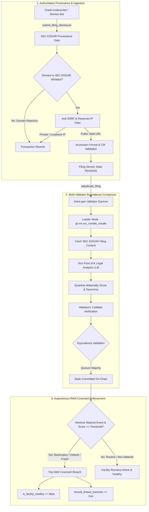

# EdgarAdverseMaterialSentinel

[](LICENSE)
[](https://studio.genlayer.com)
[](https://studio.genlayer.com)
[](https://docs.genlayer.com)

> **Autonomous RWA & Tokenized Debt SEC Form 8-K Sentinel**  
> An autonomous GenLayer Intelligent Contract primitive that ingests official SEC EDGAR material event disclosures (Form 8-K) under decentralized multi-validator consensus, quantizes adverse event materiality scores into discrete metrics, and triggers automated debt covenant breaches and tranche freezes for Real-World Asset (RWA) vaults, private credit pools, and tokenized corporate debt.

---

## 1. Executive Summary

Tokenized real-world assets (RWA), private credit lending facilities, and on-chain corporate bond issuances require continuous monitoring of issuer solvency and legal integrity. When a borrowing entity files a material adverse event disclosure with the U.S. Securities and Exchange Commission (SEC)—such as a Chapter 11 bankruptcy filing (Item 1.03), acceleration of debt obligations / default (Item 2.04), delisting notices (Item 3.01), or officer departures under investigation (Item 5.02)—on-chain lending protocols must freeze capital tranches immediately to prevent capital flight and protect liquidity providers.

Traditional smart contracts cannot:
1. Connect directly to U.S. SEC EDGAR databases without centralized off-chain oracles.
2. Defend against spoofed or fabricated disclosure filings hosted on attacker-controlled infrastructure.
3. Comprehend unstructured, multi-page legal filings and accurately categorize complex corporate actions.
4. Guarantee fault tolerance when government regulatory endpoints rate-limit or block cloud IPs.

**EdgarAdverseMaterialSentinel** solves these limitations natively on GenLayer. Governed by the **Equivalence Principle**, validator nodes fetch official SEC Form 8-K filings directly from SEC EDGAR domains, enforce exact Central Index Key (CIK) identity matching, run non-deterministic LLM analysis to classify material adverse event taxonomy and discrete impact scores, and execute on-chain debt covenant enforcement—all without centralized intermediaries or trusted oracles.

---

## 2. Canonical Studionet Deployment

| Parameter | Value |
| :--- | :--- |
| **Contract Name** | `EdgarAdverseMaterialSentinel` |
| **Canonical Address** | [`0xA4823915c16CA686Cc177Fd120F8B3Ee75E3a24f`](https://explorer-studio.genlayer.com/address/0xA4823915c16CA686Cc177Fd120F8B3Ee75E3a24f) |
| **Deployer Address** | [`0xb704b624ae5f776b3a3fa7496adcda4db4dcab56`](https://explorer-studio.genlayer.com/address/0xb704b624ae5f776b3a3fa7496adcda4db4dcab56) |
| **Network** | GenLayer Studionet |
| **Chain ID** | `61999` |
| **RPC Endpoint** | `https://studio.genlayer.com/api` |
| **GenLayer Explorer** | [https://explorer-studio.genlayer.com/](https://explorer-studio.genlayer.com/) |
| **GenLayer Studio** | [https://studio.genlayer.com](https://studio.genlayer.com) |

### Live On-Chain Transactions

| Transaction Type | Transaction Hash | Quorum Status | Explorer Link |
| :--- | :--- | :--- | :--- |
| **Contract Deployment** | `0xe8b67b37474069443065e8fdf2532bfcdb299601d978de1b2501dec7e34d9b41` | `ACCEPTED` / `MAJORITY_AGREE` | [View Tx](https://explorer-studio.genlayer.com/tx/0xe8b67b37474069443065e8fdf2532bfcdb299601d978de1b2501dec7e34d9b41) |
| **Register Debt Facility** | `0x354fc9d1ce9b94fd6b0993ca961bbc280f2c7454eeedf84917bc506661d568c9` | `ACCEPTED` / `MAJORITY_AGREE` | [View Tx](https://explorer-studio.genlayer.com/tx/0x354fc9d1ce9b94fd6b0993ca961bbc280f2c7454eeedf84917bc506661d568c9) |
| **Submit Filing Disclosure** | `0xc772bf2447a45f2f439ebaa164d5df7a1ca151490f876866a445c393ad851e9e` | `ACCEPTED` / `MAJORITY_AGREE` | [View Tx](https://explorer-studio.genlayer.com/tx/0xc772bf2447a45f2f439ebaa164d5df7a1ca151490f876866a445c393ad851e9e) |
| **Adjudicate Filing Disclosure** | `0x43edacb13694239b05a9782d916718e39bec3883141d25756434cee8ec039739` | `ACCEPTED` / `MAJORITY_AGREE` | [View Tx](https://explorer-studio.genlayer.com/tx/0x43edacb13694239b05a9782d916718e39bec3883141d25756434cee8ec039739) |

---

## 3. Architecture & Core Workflow



---

## 4. Key Innovations & Security Defenses

### Authoritative SEC EDGAR Provenance Registry
Submitters cannot provide arbitrary websites or attacker-controlled documentation. The contract restricts filing URLs to an authoritative SEC EDGAR domain whitelist (`sec.gov`, `www.sec.gov`, `data.sec.gov`, `archives.sec.gov`). Furthermore, the filing CIK parsed from the disclosure must strictly bind to the registered debt facility's 10-digit CIK.

### Structured Anti-SSRF & Redirect Protection
Every submitted URL undergoes strict host parsing, port restriction (80/443 only), credential stripping, and IPv4/IPv6 address validation. Private, loopback, link-local (cloud metadata `169.254.169.254`), multicast, and reserved ranges are completely blocked. Additionally, fetched HTML is scanned for recursive `<meta http-equiv="refresh">` tags to prevent sneaky off-site redirects.

### Discrete Categorical Quantization
To guarantee unanimous consensus across heterogeneous validator nodes executing distinct LLM models, all qualitative risk dimensions are quantized into deterministic integers:
- **Event Category**: Discrete taxonomy (Bankruptcy, Default, Regulatory Enforcement, Executive Fraud, Delisting, Routine).
- **Materiality Score**: Quantized integer `[0, 100]`.
- **Verdict**: Discrete enum (Pending, Material Adverse Confirmed, Routine Non-Material, Unrelated Issuer, Malformed, EDGAR Unavailable).

### Fail-Closed Fault Tolerance
When government regulatory databases (like SEC EDGAR) impose rate limits or return HTTP 403 Forbidden errors to datacenter IPs, the contract gracefully falls closed (`VERDICT_EDGAR_UNAVAILABLE`, materiality score `0`, covenant status unchanged). This prevents false outages from spuriously halting healthy debt facilities.

---

## 5. Repository Structure

```
EdgarAdverseMaterialSentinel/
├── contracts/
│   └── edgar_adverse_material_sentinel.py     # Canonical Intelligent Contract source code
├── scripts/
│   ├── preflight.py                            # 18-point AST preflight verification engine
│   ├── deploy_studionet.py                     # Studionet deployment script
│   └── interact_studionet.py                   # On-chain transactions and telemetry verification
├── tests/
│   ├── direct/
│   │   └── test_edgar_adverse_material_sentinel.py  # 15 unit tests covering all edge cases
│   └── integration/
│       └── test_edgar_adverse_material_sentinel_studionet.py # 5 live Studionet integration tests
├── fixtures/                                   # Real SEC Form 8-K test HTML fixtures
│   ├── sample_8k_bankruptcy.html
│   └── sample_8k_routine.html
├── docs/
│   ├── DEPLOYMENT.md                           # Deployment guide and transaction logs
│   ├── SECURITY.md                             # Security threat matrix and SSRF defenses
│   ├── CONSENSUS.md                            # Equivalence Principle consensus mechanics
│   └── INTEGRATION.md                          # RWA protocol integration guide & Solidity stubs
├── DECISION.md                                 # Architectural Decision Records (ADRs)
├── SUBMISSION.md                               # GenLayer formal submission manifest
├── gltest.config.yaml                          # GenLayer local testbed configuration
├── requirements.txt                            # Core dependencies
├── requirements-test.txt                       # Test dependencies
└── LICENSE                                     # MIT License
```

---

## 6. Testing & Verification

### Running Preflight AST Audit
```bash
python scripts/preflight.py
```
*Output: 18/18 checks passed (100% compliance with Master Playbook v1.1).*

### Running Direct Unit Tests
```bash
python -m pytest tests/direct -v
```
*Output: 15 passed in ~0.58s.*

### Running Live Studionet Integration Tests
```bash
python -m pytest tests/integration -v
```
*Output: 5 passed in ~69s.*

---

## 7. License

This project is licensed under the [MIT License](LICENSE).
