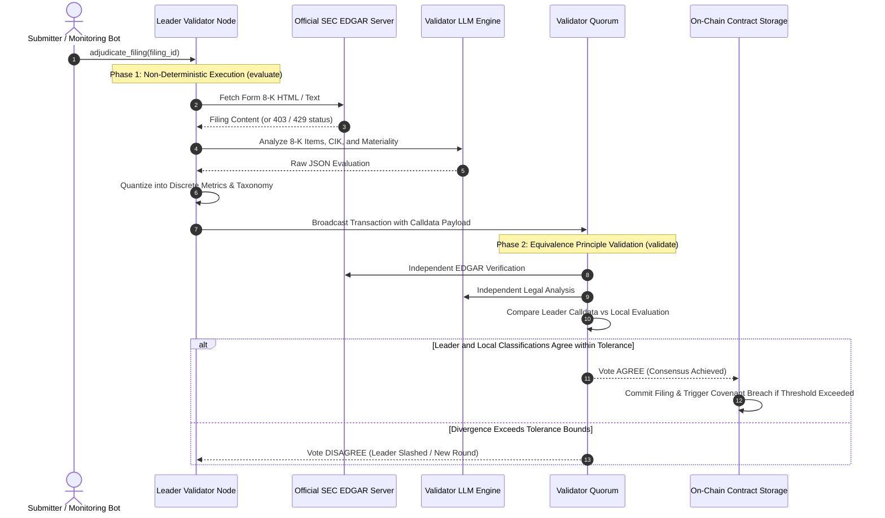

# Equivalence Principle Consensus Architecture

## Introduction

In decentralized smart contract platforms, all operations must be strictly deterministic so that all validator nodes arrive at identical state roots. Traditional blockchains achieve this by forbidding smart contracts from accessing the internet or running artificial intelligence models.

GenLayer eliminates this limitation through the **Equivalence Principle**. Instead of requiring identical bitwise execution across all nodes, GenLayer validators independently assess whether a leader node's non-deterministic output satisfies a bounded, deterministic equivalence rule.

---

## 1. How the Equivalence Principle Operates

In `EdgarAdverseMaterialSentinel`, non-deterministic web retrieval and legal text analysis are executed inside `gl.vm.run_nondet_unsafe(evaluate, validate)`:



---

## 2. Phase 1: Leader Execution (`evaluate`)

The leader node performs the non-deterministic evaluation:
1. **Network Fetch**: Fetches filing text from the whitelisted SEC EDGAR domain using `gl.nondet.web.get(url)`.
2. **Deterministic Fallback (Fail-Closed)**: If the SEC server returns a non-200 status code (such as HTTP 403 bot-detection or 429 rate limit) or an invalid response, the leader immediately returns:
   ```json
   {
       "event_category": 0,
       "materiality_score": 0,
       "covenant_breach_detected": false,
       "verdict": 5,
       "summary": "SEC EDGAR endpoint returned HTTP status 403."
   }
   ```
3. **Legal Text Analysis**: If content is available, the leader queries the LLM via `gl.nondet.exec_prompt(prompt, response_format="json")` to extract:
   - Filing CIK and issuer identity.
   - Form 8-K triggering event items (Bankruptcy, Debt Acceleration, Delisting, etc.).
   - Quantized materiality score `0..100`.
   - Discrete verdict.

---

## 3. Phase 2: Quorum Validation (`validate`)

Each validator node receives the transaction and executes the `validate(leader_result)` function:

### 1. Dual-Path Calldata Extraction
To maintain full compatibility between live Studionet validator environments and local test fixtures:
```python
if hasattr(leader_result, "calldata"):
    candidate_data = leader_result.calldata
else:
    candidate_data = leader_result
```

### 2. Equivalence Criteria
Validators reach consensus by testing the following invariants:
1. **Verdicts Match**: If both nodes identify an adverse material event (`VERDICT_MATERIAL_ADVERSE_CONFIRMED`), they agree.
2. **Event Taxonomy Matches**: Both nodes must classify the event into the same Form 8-K category (e.g. `CATEGORY_BANKRUPTCY_RECEIVERSHIP`).
3. **Bounded Metric Delta**: The leader's materiality score must be within $\pm 15$ points of the validator's score:
   $$\left| \text{score}_{\text{leader}} - \text{score}_{\text{validator}} \right| \le 15$$
4. **Fail-Closed Consensus**: If both nodes observe that SEC EDGAR is unreachable or returned HTTP 403, both return `VERDICT_EDGAR_UNAVAILABLE` and agree unanimously.

---

## 4. On-Chain State Commitment

Once a quorum of validators votes `AGREE`, the contract commits the state:
- The filing record is marked `STATUS_ADJUDICATED` with the verified score and summary.
- If `covenant_breach_detected` is `True` and `materiality_score >= facility.covenant_breach_threshold`, the facility record is marked `is_covenant_breached = True`.
- Downstream RWA credit protocols querying `should_freeze_tranches(facility_id)` will immediately receive `True`, halting unauthorized withdrawals or tranche rebalancing.
